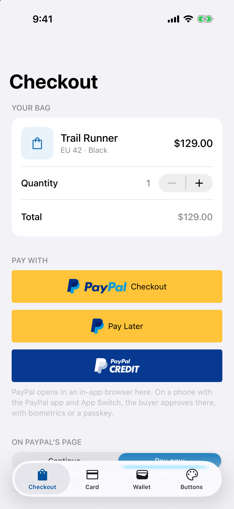
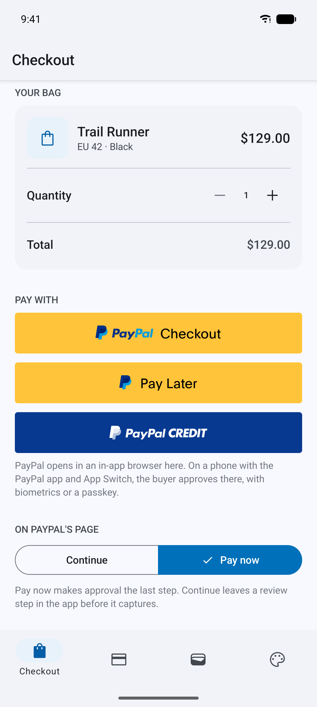
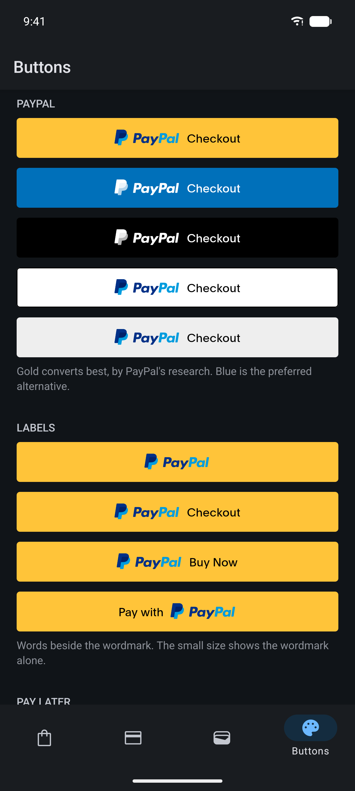

# expo-paypal

[](https://www.npmjs.com/package/@hzblj/expo-paypal)
[](./LICENSE)

PayPal for Expo on the native PayPal SDK 3 (iOS and Android): PayPal Checkout with App Switch, Pay Later and PayPal Credit, vaulting, card payments with 3D Secure, PayPal's own payment buttons and device data. Every flow is one promise that resolves `approved` or `canceled`.

<p>
  
  
  
  
</p>

```sh
npx expo install @hzblj/expo-paypal
```

```ts
PayPal.configure({clientId, environment: 'sandbox', merchantId})

const result = await PayPal.checkout({orderId: () => api.createOrder(cart)})

if (result.status === 'approved') {
  await api.captureOrder(result.orderId)
}
```

**[Documentation](./packages/expo-paypal/README.md)**: the config plugin, every flow, the buttons, errors and platform behavior.

## This repository

| Path | What lives there |
| --- | --- |
| `packages/expo-paypal/` | `@hzblj/expo-paypal`, the published package: the JavaScript API, the config plugin, the iOS and Android module |
| `apps/example/` | The example app, built from [Kara UI](https://github.com/hzblj/kara-ui): every flow against the PayPal sandbox, with API routes that create and capture the orders, and all the buttons |
| `media/` | The example on iOS and Android, light and dark: what the README shows |

```sh
yarn                 # install
yarn prebuild        # build the package, then a clean `expo prebuild` of the example
yarn ios             # run the example on iOS (dev client); `yarn android` for Android
yarn start           # Metro for the example
yarn test            # the JavaScript and config plugin tests
yarn test:ios        # the iOS module's logic, with SwiftPM on the Mac
yarn test:android    # the Android module's logic, on the JVM (after `yarn prebuild`)
yarn lint            # Biome and TypeScript
yarn pack:check      # pack the package as npm gets it and type-check a consumer
yarn changeset       # describe a change for the next release
```

The example needs a PayPal sandbox app: copy `apps/example/.env.example` to `apps/example/.env` and fill it in.

## More libraries

The other libraries from the same author are at **[libraries.janblazej.dev](https://www.libraries.janblazej.dev)**.

## Sponsorship

<a href="https://www.buymeacoffee.com/hzblj"></a>

## License

MIT © Jan Blazej
